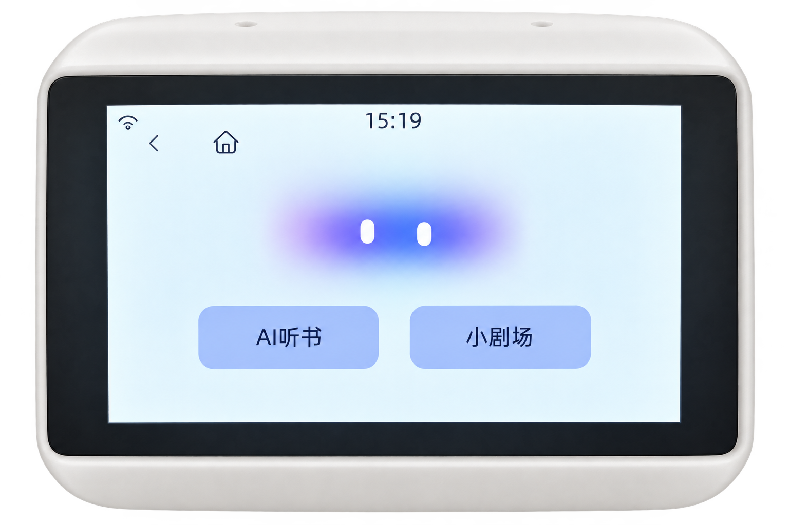
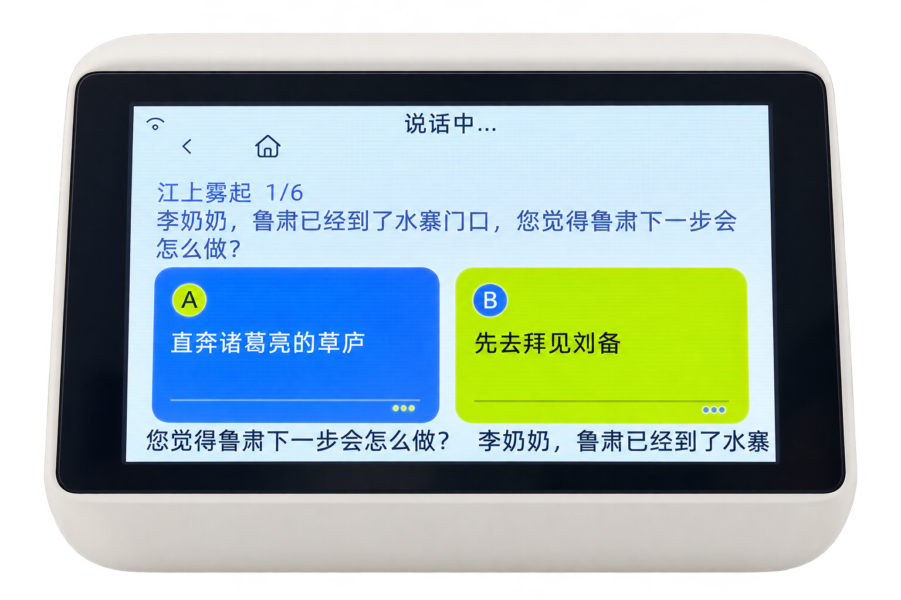
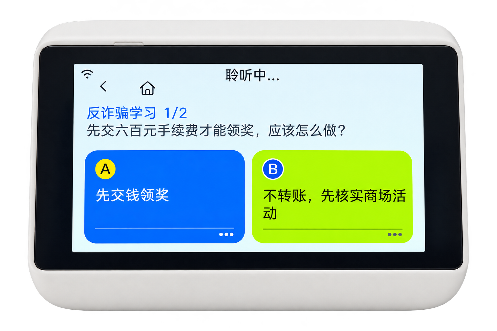

# Listening Companion

An elderly companion robot built on the [XiaoZhi AI](https://github.com/78/xiaozhi-esp32) firmware framework.

Listening Companion combines natural voice conversation, a touch-friendly interface, interactive stories, anti-fraud education, and family-oriented care features in a desktop device. The project is designed for older adults who may spend long periods alone and need an accessible way to talk, listen, learn, and stay connected with their families.

<p align="center">
  
</p>

> [!IMPORTANT]
> This repository contains the device firmware. The companion backend and service console used by this deployment run inside the private network of the author's internship organization. They are not public Internet services and cannot be reached without authorized access to that internal network.

## Overview

The project keeps the proven audio, networking, display, and MCP foundations of XiaoZhi AI, then adds a user experience focused on older adults. Large touch targets, voice-first interaction, spoken feedback, and simple navigation make the device usable without a phone or keyboard.

The current firmware targets the **Hiwonder ESP32-S3 board**, registered in the source tree as `HiwonderExploit_S3`. Its screen, audio codec, touch controller, camera, button, and I/O expander are initialized by a dedicated board implementation under `main/boards/HiwonderExploit_S3/`.

The device works together with an internal backend that provides speech services, dialogue generation, story state, anti-fraud content, and optional family-care workflows. The firmware handles local peripherals and interaction state while the backend performs the heavier AI and content tasks.

## Main Experiences

### Daily Companionship

The normal conversation mode provides a simple voice interface for everyday use. Users can wake the device, speak naturally, hear a streamed response, and read the current text on screen without navigating complex menus.

### Interactive Reading

Interactive Reading turns an audiobook into a participatory story. At key moments, users choose the next plot direction by touch or voice. The device also supports story history and continuing unfinished stories.

<p align="center">
  
</p>

### Anti-Fraud Education

The anti-fraud mode presents common scams as short interactive scenarios. Users listen to a situation, choose a response, and learn the safer course of action through dialogue and audio. The backend converts selected public cases into senior-friendly lessons and manages content updates.

<p align="center">
  
</p>

## Hardware

### Supported Board

This branch currently adapts the firmware for **Hiwonder Exploit S3** (`HiwonderExploit_S3`), based on the ESP32-S3 platform. The release configuration selects:

- target: `esp32s3`
- board implementation: `main/boards/HiwonderExploit_S3/`
- custom partition table: `partitions/v2/16m_hiwonder.csv`
- wake-word detection while listening

### Peripheral Integration

The Hiwonder board layer implements the following hardware path:

- **320 × 240 touch display** using an SPI LCD and LVGL input device
- **Touch controller** on I2C address `0x38`
- **ES8311 audio codec** with 16 kHz microphone input and speaker output
- **I2S audio bus** for microphone capture and synthesized speech playback
- **Camera interface** connected to the ESP32-S3 parallel camera pins
- **Wi-Fi networking** through the XiaoZhi `WifiBoard` base implementation
- **Boot/action button** on GPIO 0
- **XL9555 I/O expander** for audio power and display backlight control
- **16 MB partition layout** for the Hiwonder firmware build

The dedicated board class initializes the SPI and I2C buses, probes touch hardware, configures the camera, creates the LCD display, starts the camera uploader, and exposes the audio codec and peripherals to the common application layer.

### Device-Side Capabilities

- Offline wake-word detection through ESP-SR
- Streaming speech input and speech playback
- Opus audio encoding and decoding
- Touch and voice interaction
- Large-format subtitles and A/B choice pages
- Interactive Reading and anti-fraud UI capability negotiation
- Camera capture support
- Wi-Fi provisioning and reconnection
- MCP support for extensible device control

## System Architecture

The deployment has three cooperating parts:

1. **Companion device**: captures speech and touch input, renders the interface, plays audio, and maintains local interaction state.
2. **Backend and service console**: runs speech, dialogue, story, content, and management services.
3. **Optional family client**: receives authorized summaries and sends supported content or screening tasks.

The device does not run the full AI stack locally. It streams compact audio to the backend and receives generated speech plus structured UI commands. This keeps the embedded firmware responsive while allowing the service side to maintain dialogue context and content state.

## Device-to-Server Communication

### WebSocket Session

The customized experiences use the existing XiaoZhi WebSocket connection. When a voice session opens, the firmware connects to the configured endpoint and sends authentication and device metadata in the handshake:

- `Authorization: Bearer <token>`
- `Protocol-Version`
- `Device-Id`
- `Client-Id`

The device then sends a JSON `hello` message describing its audio parameters and supported features. For this board, the feature set can include touch-enabled Interactive Reading and anti-fraud interfaces.

### Audio and Control Data

The same WebSocket carries two kinds of traffic:

- **Binary frames** contain Opus audio for microphone upload and TTS playback.
- **UTF-8 JSON text frames** carry session state, speech events, UI actions, MCP messages, and application-specific commands.

Interactive Reading and anti-fraud interactions reuse this connection for page state, choices, confirmations, and playback control. The detailed message definitions remain in the protocol documents rather than being duplicated here.

See the protocol documents for implementation details:

- [WebSocket protocol](docs/websocket.md)
- [Interactive Reading board protocol V2](docs/interactive-story-board-v2.md)
- [Frontend/backend communication audit](docs/frontend-backend-communication-audit.md)
- [MQTT + UDP protocol](docs/mqtt-udp.md)
- [MCP interaction flow](docs/mcp-protocol.md)

### Internal-Network Service Console

The backend and service console used for this project connect to the **private intranet of the author's internship organization**. The repository intentionally does not publish internal hostnames, IP addresses, access tokens, credentials, or deployment procedures.

To run the complete deployed system, a developer must have permission to access that network and must receive the endpoint and credentials through the organization's approved process. A device on the public Internet will not reach the internal service directly. Do not hard-code private addresses or secrets in source files or commits.

Developers outside that environment can still study and build the firmware, but the AI dialogue, story, anti-fraud, family-client, and service-console workflows require a compatible XiaoZhi backend or an authorized internal deployment.

## Repository Layout

```text
main/
├── audio/                         Audio capture, codecs, wake word, and playback
├── boards/HiwonderExploit_S3/     Hiwonder ESP32-S3 hardware adaptation
├── camera_agent/                  Camera upload and camera-related functions
├── display/                       LCD, LVGL, images, fonts, and themes
├── protocols/                     WebSocket and MQTT protocol implementations
└── story/                         Interactive Reading and anti-fraud UI logic

docs/                              Protocol and developer documentation
partitions/v2/16m_hiwonder.csv     Hiwonder flash layout
scripts/                           Build, release, and asset utilities
```

`main_backup_before_hiwonder/` is a reference snapshot and is not active application source. Generated `build/` output and downloaded `managed_components/` dependencies should not be edited manually.

## Acknowledgements

This project is built on the open-source [XiaoZhi ESP32](https://github.com/78/xiaozhi-esp32) ecosystem and retains its core embedded architecture, audio pipeline, protocol support, and MCP extensibility. The elderly-care interaction design and Hiwonder ESP32-S3 adaptation were developed for the Listening Companion prototype.

## License

This repository follows the license terms in [LICENSE](LICENSE). Third-party components and content may have their own licenses or usage requirements.
